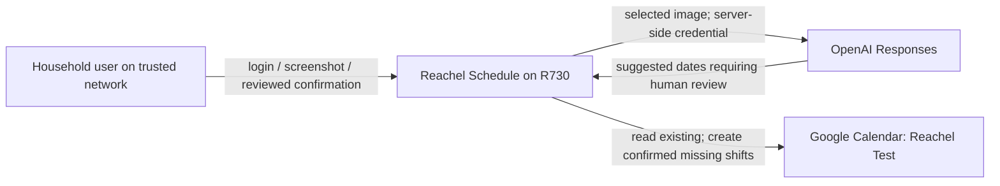
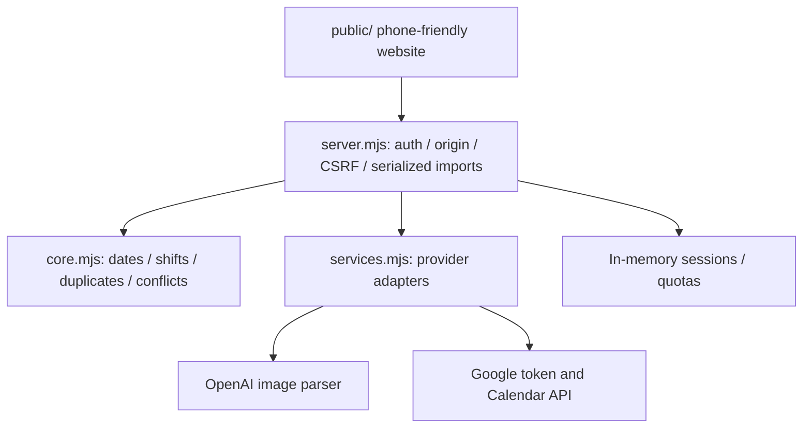
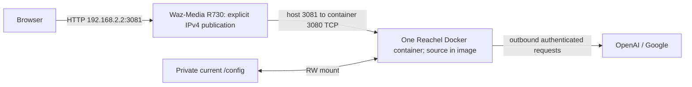

# Reachel architecture and source map

Maintainer: Existing application worker for behavior; R730 Operations for host/runtime; Historian for guide structure.
Reviewed: 2026-11-05 (America/Chicago).
Status: documentation pilot; source and dated evidence, no runtime changes.

## Context and trust boundaries

The browser never gets provider credentials. AI extraction is a suggestion; date
validation and existing-event checks are deterministic. A service account is a
Google identity used by software. Give it event-edit access only to the intended
calendar, not calendar-sharing administration or domain-wide delegation.

## Components

An API is a programmatic service interface. The server serializes imports and
uses deterministic event IDs plus existing-event checks to reduce duplicate
creation. An uncertain write still requires Calendar inspection before retrying.
No automatic delete/update workflow exists. Restart clears in-memory sessions
and limits; it does not erase events already created in Google Calendar.

## Installed deployment

A Docker image contains code; a running container uses it. This deployment diagram
uses Docker's meaning of container, not a requirement to put every architectural
component in its own process. The current private IP binding is not evidence of
firewall isolation or phone-subnet reachability. No proxy/NAT/DNS change was part
of the accepted cutover. HTTP traffic is plaintext.

## Source map

| Source | Responsibility |
|---|---|
| `server.mjs` | Config/startup, routes/static files, shared-password sessions, origin/CSRF, request limits/import serialization and graceful shutdown |
| `core.mjs` | Fixed calendar, validated dates, zone-aware shifts, existing/conflict classification and duplicate-safe import decisions |
| `services.mjs` | OpenAI parsing, Google service-account authentication, tokens and Calendar adapter |
| `public/index.html`, `public/app.js`, remaining `public/` assets | Login, file selection, editable review, checks/confirmation and six served website/icon assets |
| `setup.mjs` | New development configuration creation |
| `test/core.test.mjs`, `server.test.mjs`, `services.test.mjs`, `shutdown.test.mjs` | Synthetic logic/adapters/auth and Linux shutdown coverage |
| `.github/workflows/test-pr.yml`, `publish-image.yml` | PR checks versus main-branch image publication |

Open [the source tree](../README.md) from the repository root. The [deployment guide](deployment.md)
separates tested source behavior from untested installed user/provider flows.
